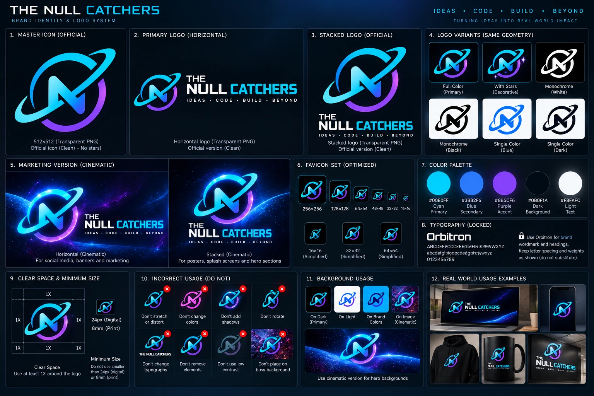

# Logo usage and export verification

| Placement | Export | Background |
|---|---|---|
| Headers and banners | [Horizontal wordmark](../logos/vector/null-catchers-logo-horizontal.svg) | Brand Dark `#0B0F1A` or Surface `#1F2937` |
| Centered title cards | [Stacked wordmark](../logos/vector/null-catchers-logo-stacked.svg) | Brand Dark or Surface |
| Single-color mark | [Black SVG](../logos/monochrome/null-catchers-icon-black.svg) | Brand Light `#F8FAFC` |
| Reversed single-color mark | [White SVG](../logos/monochrome/null-catchers-icon-white.svg) | Brand Dark or Surface |
| App icon | [Official transparent mark](../logos/official/null-catchers-icon-master.png) | Review in the target platform frame |

Allow the token-defined `1x` clear space on each side. For layout measurement, use one N-stroke width in the rendered mark as `x`. The mark's minimum is 24 CSS pixels on the web or 8 mm in print. For wordmarks, increase the size until the lettering and tagline are legible at the final output size. Use the dedicated 16 px favicon for the browser tab.

The horizontal vector wordmark uses Light and Cyan lettering. Light has a contrast ratio of 18.29:1 on Dark and 14.03:1 on Surface. Cyan has a ratio of 11.94:1 on Dark and 9.16:1 on Surface. On Light, Cyan measures 1.53:1. The black and white marks measure 20.07:1 on Light and 19.13:1 on Dark, respectively. The figures apply to the solid color pairs.

## Raster export checks

All eight size-labelled shared PNG icons match their square dimensions. The 70 files listed in the [project manifest](../projects/manifest.json) also match their size labels or the project's declared master dimensions. The [shared favicon](../icons/favicon.ico) contains one 16 × 16 image.

| Official PNG | Pixel dimensions |
|---|---:|
| [Icon master](../logos/official/null-catchers-icon-master.png) | 1254 × 1254 |
| [Horizontal logo](../logos/official/null-catchers-logo-horizontal.png) | 2172 × 724 |

## Rights and attribution

The repository identifies The Null Catchers as the brand and lists Orbitron and Inter as the fonts. It currently provides no asset license or font attribution notice. Confirm asset redistribution rights with the brand owner before packaging, and include the upstream license and notices for any font files you distribute.
